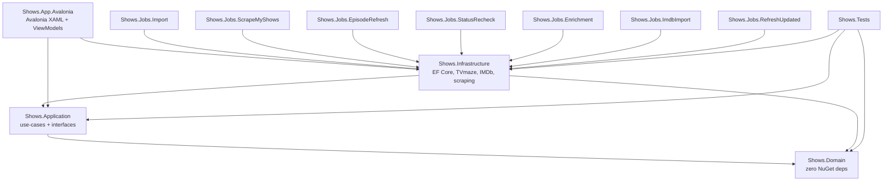

# ARCHITECTURE — Layer Rules and Project Graph

Version 1.3, 2026-09-28. v1.1: domain types follow the TVmaze model (SPEC P1), the enrichment
mapper is a named component (P3/R11), source tables are banned from Application, and logging gets a
project-wide policy (§7).
v1.2: user data moves to `user_show` with a logical delete (SPEC P4, ADR-024), the mapper may not
regenerate ids, and surrogate keys are client-generated (ADR-026).
v1.3: the key layout is fixed as a 64-bit time-ordered integer (ADR-027), and **concurrency** becomes a
cross-cutting decision with `IWriterLease` (ADR-028).

---

## 1. Driving constraint

Iteration 2 splits this into a Dockerized frontend + backend. The requirement is therefore not
"clean code" but a **specific seam**: `Shows.Application` must be hostable by an ASP.NET Core API
with **zero changes to it**. Everything below serves that.

The UI is **Avalonia** (XAML, MVVM via `CommunityToolkit.Mvvm`) — see ADR-033, which superseded the
original MAUI choice (ADR-001). It is a plain `net8.0` desktop app (no Windows TFM, no MAUI workload),
which fits the iteration-2 Docker/Linux story. Only Domain, Application, and Infrastructure carry forward
unchanged. Do not sink logic into the UI to "save time" — keep it thin so the iteration-2 split stays cheap.

---

## 2. Project graph



`U --> I` is composition root only: the Avalonia `Program.cs` calls
`Services.AddShowsInfrastructure()` and nothing else. **No View or ViewModel may name an
Infrastructure type.** Enforced by the architecture test (Rule 4), which scans `Shows.App.Avalonia`
and exempts only `Program.cs` / `App.axaml.cs`.

---

## 3. Layer contracts

### Shows.Domain
Entities, enums, value objects, and pure domain logic. **Zero NuGet packages.** No EF attributes,
no `System.Text.Json` attributes, no navigation-property tricks. Plain C#.

Types: `TrackedShow`, `UserShow`, `Season`, `Episode`, `EpisodeWatch`, `Genre`, and the enums
`ShowCategory` (`Started`, `Later`, `Cancelled`, `Finished`), `ShowStatus` and `EpisodeType` (both
with an `Unknown` member, SPEC R12). Plus the progress calculation implementing SPEC R5/R7 as a pure
function, so it is unit-testable without a database.

There is **no `Show` entity** in v1.1: the only show-shaped entity is `TrackedShow`, whose fields are
named after the TVmaze payload (SPEC P1). Domain knows nothing about myshows.me and has no
`MyShowsId` — a myshows identifier appearing anywhere in Domain is a bug (ADR-019).

`TrackedShow` and `UserShow` are separate entities because they have different owners and lifetimes
(SPEC P4), but the UI should see them as one aggregate — a `TrackedShow` that exposes `Category`,
`AddedAt` and `IsDeleted` rather than making every ViewModel reach across two tables. Where that
aggregate is assembled (repository vs use-case) is decided at step 1.4; what matters is that the
`deleted_at IS NULL` filter is applied **once**, in the repository, and is not something each caller
remembers.

### Shows.Application
Use-cases (verbs): `SearchShows`, `AddShowToTracking`, `ToggleWatchedEpisode`,
`GetCategoryOverview`, `GetShowDetails`, `GetUpcomingShows`, `ChangeCategory`, `RecomputeProgress`.

Declares all interfaces:
- `ITrackedShowRepository`, `IEpisodeRepository`, `IUserShowRepository`, `IUiStateRepository`
- `ICatalogProvider` — the second-provider seam (SPEC F2)
- `IImdbIdResolver`, `IImdbDatasetReader`
- `IShowMapper` — the single enrichment mapper (SPEC R11). `MapShowAsync(tvmazeId, ct)` writes
  source rows and upserts the mapped rows; `AddShowToTracking` is a thin call over it (ADR-023)
- `IIdGenerator` — client-side surrogate keys (ADR-026). One seam, injected, so tests can make ids
  deterministic and assert the mapper does not regenerate them. Returns `long`; the layout is fixed by
  ADR-027 and lives in Infrastructure, so Domain and Application stay dependency-free
- `IWriterLease` — acquire/renew/release for bulk write operations (ADR-028). Returns a handle whose
  `Renew()` reports lease loss, so no job hand-rolls lease SQL
- `IUnitOfWork`

Rules:
- Returns Domain types. **`IQueryable` must never escape this layer.**
- No `async` without `ConfigureAwait(false)`-safe design; no `.Result`, no `.Wait()`.
- No reference to `Microsoft.EntityFrameworkCore`, `System.Net.Http`, `Microsoft.Maui`, or
  `Newtonsoft.Json`. Verified by the architecture tests in step 8.1.
- **Never names a source table.** Application reads results through repositories and never
  selects from `tvmaze_*`, `imdb_*`, or `staging_*` (SPEC P3). The mapper is the only thing that
  crosses that line, and it lives in Infrastructure.

### Shows.Infrastructure
`ShowsDbContext`, configurations, migrations, repositories, `UnitOfWork`, `TvmazeCatalogProvider`,
`TvmazeShowMapper` (the one implementation of `IShowMapper`), `MyShowsScraper`,
`ImdbDatasetReader`, `DataPaths`, `AddShowsInfrastructure()`, `AddShowsLogging()` (§7).

Owns all DTOs and JSON attributes. Maps DTO → Domain at the boundary, and source rows → result rows
via the mapper. Raw-SQL bulk paths live here and are allowed to bypass EF — but only here, and they
must be documented at the method.

The mapper is the **only** class permitted to read `tvmaze_*`/`imdb_*` and write
`tracked_show`/`season`/`episode`. It is idempotent and must never touch `user_show`,
`episode_watch` or `ui_season_state` (SPEC P4) — user-authored data survives any number of re-maps.

It also **never regenerates a surrogate id**. `episode_watch.episode_id` and
`ui_season_state.season_id` point at them, so a mapper that deletes and re-inserts an episode
silently orphans the user's watch marks while reporting a clean run. Upsert on natural keys, leave
existing ids alone, and never delete a mapped row to reflect a provider change — retire it in place.
This is what makes the rebuild drill in `SCHEMA.md` §2a possible at all.

### Shows.App
MAUI head, XAML views, ViewModels (`CommunityToolkit.Mvvm`), `Shell` navigation, value converters.
ViewModels talk only to Application use-cases. Keep ViewModels thin and free of `MCT`-specific
types where practical so a Blazor port is mechanical.

### Shows.Jobs.*
One console project per job, each a thin `Host.CreateApplicationBuilder` shell: parse args, resolve a
use-case or service from Infrastructure, run, log, exit with a meaningful code. **No business logic
in `Program.cs`.** Separate projects because the user runs them manually on different cadences.

---

## 4. Configuration

`appsettings.json` lives in Infrastructure, read via a `DataPaths` service:

```json
{
  "Data": {
    "DatabasePath": "data/shows.db",
    "ImdbDatasetPath": "data/imdb"
  },
  "Tvmaze": {
    "BaseUrl": "https://api.tvmaze.com",
    "UserAgent": "ShowsTracker/1.0 (personal use)",
    "MinRequestIntervalMs": 250
  },
  "MyShows": {
    "BaseUrl": "https://myshows.me",
    "MinRequestIntervalMs": 1500,
    "MaxRequestsPerRun": 600
  },
  "Sync": {
    "LeaseLifetimeSeconds": 90,
    "LeaseRenewIntervalSeconds": 30
  },
  "Proxy": {
    "Tvmaze": "http://main-pc:10801",
    "MyShows": "",
    "Imdb": ""
  },
  "Http": {
    "ConnectTimeoutSeconds": 10,
    "RequestTimeoutSeconds": 60
  },
  "Cache": {
    "NoValidatorCacheMaxAgeHours": 24
  },
  "Links": {
    "Tvmaze": "https://www.tvmaze.com/shows/{0}",
    "Imdb": "https://www.imdb.com/title/{0}/"
  },
  "Discovery": {
    "NewShowsWindowDays": 45,
    "ArchiveLayerDays": 14,
    "ArchiveMaxAgeDays": 60,
    "PageSize": 30,
    "RefreshHours": 24,
    "ScheduleSourcePath": ""
  }
}
```

**Proxy is per service, not global** (SPEC R14). Each external host gets its own key because they are
blocked and reachable independently — on the development machine TVmaze is unreachable directly while
myshows.me and the IMDb dataset host are fine (`DATA_ANALYSIS.md` §9). One switch would either leave
TVmaze broken or push working traffic through a proxy for nothing.

The keys are the **named `IHttpClientFactory` clients** — `Tvmaze`, `MyShows`, `Imdb` — not URL
patterns. Routing is decided by which client a caller asks for, so a service cannot accidentally
inherit another's proxy and no caller has to inspect a URL to learn how it will be routed.

An **empty string means direct, explicitly**. It does not mean "inherit the machine's settings":
`DATA_ANALYSIS.md` §9.5 records that `UseProxy = true` with no explicit proxy resolves to no proxy on
this machine and behaves identically to `UseProxy = false`, so ambient settings would silently do
nothing. Absent key is treated as empty, never as ambient.

Accepted schemes are `http`, `https`, `socks4`, `socks4a`, `socks5`, or a bare `host:port` (treated as
HTTP). Anything else throws `NotSupportedException` at handler construction — a typo fails at startup
rather than silently sending traffic direct. **SOCKS needs no extra package** on .NET 8
(`DATA_ANALYSIS.md` §9.4), so do not add a SOCKS handler dependency.

`Http.ConnectTimeoutSeconds` exists specifically to satisfy R14's requirement that a dead proxy be
distinguishable from a slow provider. A *refused* proxy port already fails in ~2 s, but a *filtered* one
waits out the whole request timeout and looks identical to a slow host (`DATA_ANALYSIS.md` §9.6). Keep
it well below `RequestTimeoutSeconds`.

`Proxy` and `Http` are read in **one place** — the handler configuration inside
`AddShowsInfrastructure()`. No job, provider or scraper reads them; a second reader is how
per-service routing becomes per-caller routing.

Both `DatabasePath` and `ImdbDatasetPath` are resolved relative to a base data directory so the
whole app is relocatable and the Docker migration is a volume mount, not a code change.

`MinRequestIntervalMs` is enforced centrally in the HTTP handler, not per call site — a job that
loops and forgets throttling is the main risk to both external services.

### 4.1 Discovery's three look-back knobs (2026-10-07)

`/schedule/full` is **forward-only**: verified against the saved sample, its earliest air date is the day
it was captured and its latest is ~17 months ahead. A look-back window therefore has nothing below today
to find, and the buckets fill with far-future premieres. The fix is to retain dated **raw** responses and
fold them back in — an episode is only ever recoverable from a capture taken while it was still ahead.
Three settings govern that, and they are deliberately **not** derived from one another:

| Key | Owns | Why it is separate |
|---|---|---|
| `NewShowsWindowDays` | how far back the New/Airing buckets look | a display/relevance decision |
| `ArchiveLayerDays` | how long the aging capture is kept before a fetch replaces it | the spacing of captures; ~14 days is where a schedule is still dependable |
| `ArchiveMaxAgeDays` | the age at which a retained capture is deleted | how much history is worth the disk |

Deriving retention from the window would mean widening the window silently destroys history, and a window
larger than the retained span would quietly under-report instead of failing. So the source only **warns**
(once per process) when `ArchiveMaxAgeDays <= NewShowsWindowDays`, a combination that cannot fill the
window — it never clamps, because the correction belongs in configuration.

The archive stores the endpoint's **raw JSON**, never the parsed read model: `CatalogShow` is a moving
target (it gained `OfficialSite`, `PremiereDate`, `NextEpisode`), so persisting it would freeze a stale
shape with no source left to re-derive from — the inversion of SPEC P3 / ADR-022. Re-parsing an old
capture through today's parser is the intended behaviour. The captures live in the
`discovery_schedule_archive` SQLite table (SCHEMA §2), keyed by capture date. They are rebuildable cache
data rather than user watch history, but are included in a database backup; a lost archive only empties
the look-back window until it refills. Existing `cache/discovery/schedule-*.json` files are left
untouched and are not imported, so the DB archive starts fresh after this storage change (ADR-035).

`Cache.NoValidatorCacheMaxAgeHours` (user-issues improvement 16) is the time-based fallback for a cached
response that carries **no** ETag/Last-Modified: with no validator to revalidate against, such an entry is
reused until it ages past this many hours (default 24 = once per day), then refetched. A response that
does carry a validator is unaffected — it is always revalidated. It is a separate section from `Http`
because `Http`/`Proxy` are read in exactly one place (the handler wiring) and this is a cache-store
concern, not a transport timing.

`Links.Tvmaze` / `Links.Imdb` (user-issues improvement 20) are the external-link URL formats, each a
`string.Format` template whose `{0}` is filled with the show's id (the TVmaze numeric id, or the IMDb
`tt` id). SPEC P5 forbids storing a URL, so the link is always built from the id at render; the *format*
lives here rather than as a code constant so both UI heads share one source of truth. The composition
root reads these and hands them to the View-layer link builder, so no View or ViewModel names an
Infrastructure type (§2). A blank format disables that link rather than emitting a broken URL.

---

## 5. Cross-cutting decisions

**HTTP.** One `HttpClient` per external host via `IHttpClientFactory`, versioned `User-Agent`,
Polly retry (exponential, jitter) + circuit breaker. TVmaze responses cached in an `http_cache`
table keyed by URL with `ETag`/`Last-Modified` revalidation; a response with **no** validator is
instead reused for up to `Cache.NoValidatorCacheMaxAgeHours` before refetch (improvement 16). All
requests to one host are **serial**
(`SemaphoreSlim(1,1)`), matching TVmaze's politeness expectations.

**Scraping isolation.** `MyShowsScraper` is reachable only from `Shows.Jobs.ScrapeMyShows`. It is
never called by a recurring job. Rationale: it is the most fragile and most ToS-sensitive
integration, so it runs once, is resumable, has a hard request cap, and can be deleted without
touching anything else.

**Time.** Store UTC everywhere. `air_date` as UTC instant plus a nullable `air_date_text` if the
original offset matters for display. Never `DateTime.Now` in Domain.

**IDs.** Client-generated, never store-assigned (ADR-026). The reason is concrete: `--promote` and
the mapper create `tracked_show`, `season` and `episode` in one transaction and need the child ids
before `SaveChanges` to build `episode_watch` rows; an identity column forces an intermediate flush.
Stable ids also survive the Docker migration, where two writers will exist. Natural keys
(`tvmaze_id`, `imdb_id`) stay as unique indexes and remain what the mapper matches on — the surrogate
key is never a merge target.

Storage is a **positive 64-bit `INTEGER`** (`long` in C#). The encoding — bit widths, epoch, mint
expression, and the EF `ValueGenerated` trap — is owned by `SCHEMA.md` §1a and is deliberately not
repeated here. UUIDv7 was rejected: 128 bits does not fit SQLite's 64-bit `INTEGER`, and `INTEGER` is
the rowid, so it is both the clustered key and the readable one (ADR-027).
One consequence belongs at the architecture level, because it is a rule about how components behave
rather than how bits are laid out:
- The salt only *reduces* the chance of a same-millisecond clash; correctness comes from `UNIQUE`
  constraints plus **whole-unit-of-work retry** on a constraint violation. Never resume a failed
  transaction — roll back and re-run the idempotent upsert with fresh ids (ADR-027).

**Concurrency.** The app and the jobs write to the same file concurrently (ADR-028). WAL and
`busy_timeout=5000` are therefore correctness requirements. WAL serialises single write transactions
but not multi-transaction bulk work, so bulk operations acquire a row in `writer_lease` and renew it on
a heartbeat; **a renewal that updates zero rows means the lease was lost and the job must stop
writing.** `--promote` is exclusive. The app takes no lease — blocking the UI because a job is running
would be worse, and interactive writes are single-row.

**Caching columns.** `watched_regular`, `total_regular`, `has_unwatched_specials`,
`auto_finish_eligible` are derived and stored. Single recompute entry point
(`RecomputeProgressUseCase`) called by every mutation path — import, toggle, and all four jobs.
Two code paths computing progress differently is the most likely source of subtle bugs in this
project.

**Migrations.** EF Core code-first, one migration per step that changes schema, applied on startup.
Staging tables are in the same context but prefixed `staging_` and never referenced by Application.

**Source vs. mapped vs. user.** Source tables (`tvmaze_*`, `imdb_*`, `staging_*`, `http_cache`) hold
third-party and pre-import data in the shape the provider gave it. Mapped tables (`tracked_show`,
`season`, `episode`, `genre`, `show_genre`) hold the derived view. User tables (`user_show`,
`episode_watch`, `ui_season_state`) hold what the user decided. Data flows one way, through the
mapper, into the mapped tables; nothing flows into the user tables except a user action or the import.
Re-running any job cannot damage user data, and neither can untracking (ADR-024). Rationale: P3/P4.

**Soft delete.** Exactly one soft-delete column in the schema: `user_show.deleted_at`. It is **not**
an EF global query filter, because the jobs and any "previously tracked" view must be able to see
soft-deleted rows — it is an explicit predicate in the read-side repository methods, so the choice
stays visible at each call site instead of being implicit in model configuration.

---

## 6. Testing strategy

| Kind | Covers | Where |
|---|---|---|
| Unit | progress rules R5/R7, backfill algorithm all 4 branches, title-selection R3 | `Shows.Tests/Unit` |
| Integration | import stage→promote against a temp SQLite file, repository behavior, migration apply | `Shows.Tests/Integration` |
| Architecture | layer reference bans, `IQueryable` containment, Domain zero-dependency | `Shows.Tests/Architecture` |
| Golden-file | the 43 shows from `episodes.json` batch `58` produce exactly the expected watched sets | `Shows.Tests/Golden` |

The golden-file test is the highest-value test in the project: it pins the inversion logic against
real data, including show `86813` → exactly 1 watched regular episode of 33.

No test may touch the network. `TvmazeCatalogProvider` is tested against recorded JSON fixtures.

## 7. Logging policy

**One configuration for every executable.** The MAUI app and all the jobs log identically; no project
gets to invent its own sinks, levels, or formats. Adding a seventh job means calling the same two
lines, nothing more.

### Setup
- `Shows.Infrastructure/Logging/logging.json` is the single source of truth, copied to each
  executable's output. Per-project `appsettings.json` files **must not** contain a `Logging` section
  — that is how drift starts.
- One extension, `IServiceCollection.AddShowsLogging(Assembly callingAssembly)`, called first in
  every `Program.cs` / `MauiProgram.cs`, before `AddShowsInfrastructure()`. It wires
  `Microsoft.Extensions.Logging` to **Serilog** with `ReadFrom.Configuration`.
- Serilog is the only logging NuGet package in the solution, and it is referenced by Infrastructure
  only. Application and Domain stay clean; call sites use `ILogger<T>`.

### Sinks
| Sink | Detail |
|---|---|
| File | `log/<appname>.log`, one file per executable — `log/Import.log`, `log/Enrichment.log`, `log/Shows.App.log`, etc. `<appname>` comes from `Assembly.GetName().Name`, never hardcoded. |
| Rolling | Roll on **size** (10 MB) with a capped count (`retainedFileCountLimit: 10`), so a runaway job cannot fill the disk. Not date-rolled: these are small personal logs and date rolls fragment them uselessly. |
| Console | Jobs only, so a manual run is readable live. The MAUI app has no console and must not attempt one. |
| Format | `[{Timestamp:HH:mm:ss.fff}] [{Level:u3}] [{SourceContext}] {Message:lj} {Exception}` — one line per event, exceptions appended. |

`log/` sits under the same base data directory as `data/` (§4) so the whole app stays relocatable and
the Docker migration is a volume mount.

### Levels
| Source | Default minimum | Override |
|---|---|---|
| `logging.json` (`Serilog:MinimumLevel:Default`) | `Information` | `LOG_LEVEL` environment variable |

The default minimum level is **config, not code** — no build-configuration (`DEBUG`/`Release`) branch.
`logging.json` is the single source of truth; `LOG_LEVEL` overrides it for an ad-hoc run without
editing the file. If the config value is missing or unparseable, the resolver fails closed to
`Warning` rather than flooding the file sink.

`Serilog.Enrichers.Environment` is not used; `Serilog.Enrichers.Thread` is not used. Keep the
enrichment surface at zero until there is a reason.

### Rules
- **Never log secrets or full request bodies.** TVmaze responses go to `http_cache`, which is the
  audit trail; logs carry the URL and status code only.
- Per-item detail is `Debug`, never `Information` — 547 shows at `Information` is 547 lines of noise
  per run.
- Every job logs exactly one `Warning`-or-above line per failure with the entity id, and one
  `Information` summary line at the end (`job_run`, `SCHEMA.md` §2, mirrors it). If a job exits
  non-zero with no log entry, that is a bug in the job.
- No `Console.WriteLine` anywhere in Infrastructure or Application — it bypasses the level filter and
  disappears from the file sink. `Console.WriteLine` is legal only in `Program.cs` for user-facing
  completion messages.
- `Log.CloseAndFlush()` on every exit path, including exceptions, or the file sink loses the tail —
  which is precisely the part you need.

---
