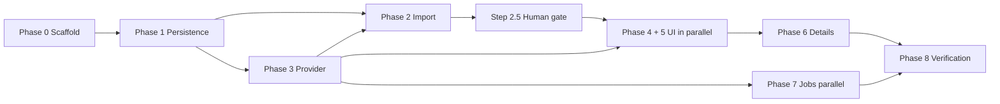

# IMPLEMENTATION_PLAN — Phased Steps with Acceptance Criteria

Version 1.3, 2026-09-28. Read `AGENTS.md` first for the documentation protocol.

v1.1 followed SPEC v1.2 / SCHEMA v1.1: **source tables are separate from mapped tables** (SPEC P3),
one **shared mapper** produces mapped rows from sources (R11, ADR-023), provider vocabularies map to
**internal enums** that fail closed (R12, ADR-022), there is **no `show` table** (ADR-020), and
**logging is configured once** for all seven executables (`ARCHITECTURE.md` §7).

v1.2 followed SPEC v1.3 / SCHEMA v1.2: **user data lives in `user_show` and untracking is a logical
delete** (ADR-024), **no derived value is stored** — no provider URLs, no season external id, both
episode provider ids nullable (ADR-025), and **surrogate keys are client-generated** (ADR-026).
Steps 1.1, 1.2, 1.4, 1.5, 2.6, 3.2, 5.1, 6.1, 7.x and 8.1 changed.

v1.3 resolves the thing that blocked step 1.1: the key is a **64-bit time-ordered `INTEGER`**
(ADR-027, UUIDv7 rejected), and **concurrent writers are supported** through a `writer_lease` row
(ADR-028). New **step 1.6** builds `IdGenerator` and `WriterLease`; steps 1.1, 1.2, 2.6 and Phase 7
changed. **Phase 1 is unblocked.**

**Every step ends with two updates**: append the evidence to the Step Log in `LOG.md`
(files changed, the verification command actually run and its observed output, deviations from
this plan and why, new facts learned, what is unblocked), and update the step status in `STATE.md`.
quote row counts.

Dependency graph is in `STATE.md`. Parallelizable work is marked **[P]**.

---

## Phase 0 — Scaffold

Nothing exists yet. Goal: a solution that builds empty, with the layer graph enforced from the first
commit. Retrofitting layer boundaries after code exists is far more expensive than declaring them
now.

### Step 0.1 — Solution and build conventions
Create `Shows.sln`, `Directory.Build.props`, `.editorconfig`, `.gitignore` (must ignore `data/`,
`*.db`, `*.tsv.gz`, `bin/`, `obj/`).

`Directory.Build.props`: `net8.0`, `LangVersion` latest, `Nullable` enable, `ImplicitUsings` enable,
`TreatWarningsAsErrors` true, `EnforceCodeStyleInBuild` true, `AnalysisLevel` latest-all.

Add `global.json` pinning the .NET 8 SDK band so agents do not accidentally build against 10.

**Verify:** `dotnet build Shows.sln` succeeds with zero warnings.

### Step 0.2 — `Shows.Domain` **[P]**
Class library, **zero `PackageReference` entries**. Add entities and enums per `ARCHITECTURE.md` §3:
`TrackedShow`, `Season`, `Episode`, `EpisodeWatch`, `Genre`, `ShowCategory`, `ShowStatus`,
`EpisodeType`. **No `Show` entity** (ADR-020) and **no `MyShowsId` anywhere** (ADR-019). Put the
progress/auto-finish rule here as a pure static function implementing SPEC R5 and R7.

`ShowStatus` and `EpisodeType` each need an `Unknown` member, and `Unknown` must never satisfy the
"is ended" test (SPEC R12).

**Verify:** `dotnet list Shows.Domain package` shows no packages. Unit tests for the progress
function: eligible case, ineligible-while-running case, and the `total_regular = 0` case from SPEC R7.
Plus a test asserting `ShowStatus.Unknown` is **not** treated as ended — this is the fail-closed rule
that prevents the ADR-022 bug class.

### Step 0.3 — `Shows.Application` **[P]**
References Domain only. Add all interfaces from `ARCHITECTURE.md` §3 — including `IShowMapper` — and
use-case classes with `Execute` methods. Bodies may throw `NotSupportedException` at this stage.

**Verify:** builds; `dotnet list Shows.Application package` shows no EF/HTTP/MAUI packages.

### Step 0.4 — `Shows.Infrastructure` **[P]**
References Application. Add EF Core + `Microsoft.EntityFrameworkCore.Sqlite`,
`Microsoft.Extensions.Http`, `Polly`, `Microsoft.Extensions.Configuration.Json`. Add `DataPaths`,
`appsettings.json` per `ARCHITECTURE.md` §4, and `AddShowsInfrastructure()` DI extension.

Configure the three named clients (`Tvmaze`, `MyShows`, `Imdb`) and their proxy here, in this one
place — SPEC R14, ADR-029. Empty proxy means direct **explicitly**: do not fall back to the machine's
settings, which are proven inert here (`DATA_ANALYSIS.md` §9.5), and do not let any caller build its own
`HttpClient`. Apply `Http:ConnectTimeoutSeconds` so a dead proxy fails before the request timeout.

**Verify:** builds; a test resolves `DataPaths` from a temp config and asserts both paths resolve
under one base directory. A second test points one named client's proxy at an unreachable
`http://127.0.0.1:1` and asserts the failure surfaces as a **transport error naming the host**, not as
an empty result set (R14) — this is the only defence against "TVmaze returned nothing" meaning
"we never reached TVmaze".

### Step 0.5 — `Shows.App` MAUI head **[P]**
`net8.0-windows10.0.19041.0` only. `CommunityToolkit.Mvvm`, MAUI `Shell` with one placeholder page.
Composition root calls `AddShowsInfrastructure()`. This is the **only** place UI may touch
Infrastructure.

**Verify:** `dotnet build Shows.App` succeeds. Record in `LOG.md` if the MAUI workload had to be
installed (`dotnet workload install maui`) — later agents need to know the setup step.

### Step 0.6 — `Shows.Tests` **[P]**
xUnit. Folders `Unit`, `Integration`, `Architecture`, `Golden`. Add `NetArchTest.Rules` (or
`ArchUnitNET`) and `Microsoft.EntityFrameworkCore.Sqlite` for temp-database tests.

**Verify:** `dotnet test` runs, even with zero tests.

### Step 0.7 — Job project shells **[P]**
Six console projects: `Import`, `ScrapeMyShows`, `EpisodeRefresh`, `StatusRecheck`, `Enrichment`,
`ImdbImport`. Each is a `Host.CreateApplicationBuilder` shell that resolves a service and exits.
**No business logic in `Program.cs`.** Each writes a `job_run` row (table arrives in 1.2; until then
log the intent).

**Verify:** each runs and exits 0 printing its name and resolved config paths.

### Step 0.8 — Logging policy, once for all executables **new**
Add Serilog (and `Serilog.Extensions.Hosting`, `Serilog.Sinks.File`, `Serilog.Sinks.Console`,
`Serilog.Settings.Configuration`) to **Infrastructure only**. Create
`Shows.Infrastructure/Logging/logging.json` per `ARCHITECTURE.md` §7 and one
`AddShowsLogging(this IServiceCollection, Assembly)` extension. Call it first in all seven
`Program.cs`/`MauiProgram.cs` files. File sink `log/<appname>.log`, `<appname>` from
`Assembly.GetName().Name`; roll on size 10 MB, retain 10. Minimum level `Warning` in Release,
`Information` in Debug, overridable by `LOG_LEVEL`. Console sink for jobs only.

Delete any `Logging` section from per-project `appsettings.json` — one config, one place.

**Verify:** run two different jobs and confirm two distinct files `log/<jobname>.log` appear with the
configured line format. Then a test that sets `LOG_LEVEL=Debug` and asserts a `Debug` line is written
while the default is not — a level filter nobody has seen fail is not a level filter. Confirm
`Log.CloseAndFlush()` runs on the exception path by throwing deliberately and checking the tail line
is present in the file.

---

## Phase 1 — Persistence

### Step 1.1 — `ShowsDbContext` and SQLite setup
`UseSqlite` with the path from `DataPaths`. On connection open: `PRAGMA journal_mode=WAL`,
`PRAGMA foreign_keys=ON`, `PRAGMA busy_timeout=5000`. Snake-case naming convention. `Migrate()` on
startup (gated on the lease rule in step 1.6 — never migrate under a live job).

**Unblocked 2026-09-28** — the key is a positive 64-bit `INTEGER`, `long` in C#, laid out per
`SCHEMA.md` §1a (ADR-027). Wire the id type as a **single EF convention** applied to every
`Id`/PK property so no entity configures its own, and set `ValueGenerated.None()` in that same
convention.

⚠️ **This is the step where ADR-026 gets silently violated.** The SQLite provider assumes an
`INTEGER PRIMARY KEY` is a store-generated rowid and will configure `ValueGenerated.OnAdd` unless told
otherwise. The model configuration is not evidence that this was handled.

**Verify:** integration test creates a temp database file, opens and closes the context, asserts the
file exists and `journal_mode` reads back as `wal`. Assert the generated migration contains **no**
`AUTOINCREMENT` anywhere — grep the script, do not trust the model configuration. Then assert
**reflectively** that no entity property in the model has `ValueGenerated != Off`:
`context.Model.GetEntityTypes().SelectMany(t => t.GetProperties()).Where(p => p.ValueGenerated != Microsoft.EntityFrameworkCore.Metadata.ValueGenerated.Never)`
must be empty. The grep catches the migration; the reflection check catches the model, which is what
actually decides whether EF tries to read a generated value back.

### Step 1.2 — Mapped and user tables, mappings, indexes, migration 1
Mapped tables from `SCHEMA.md` §2: `tracked_show`, `season`, `episode`, `genre`/`show_genre`. User
tables: **`user_show`**, `episode_watch`, `ui_season_state`. Plus `job_run`, `http_cache` and
**`writer_lease`** (ADR-028). All
indexes from §7. Migration named `0001_MainSchema`.

`tracked_show` carries the show identity and the TVmaze-derived fields and **nothing the user
authored** — `category_id`, `added_at`, `category_changed_at` and `needs_review` are on `user_show`
(ADR-024). `status_id` is the **enum** column; there is no `status_raw` here (ADR-022). No URL
columns anywhere (P5).

`user_show.tracked_show_id` is PK and FK simultaneously — configure it as a shared primary key, not
an identity column plus a unique index.

**Verify:** `dotnet ef migrations script` reviewed against `SCHEMA.md`. Test asserts each unique index
rejects duplicates, and that two rows with `NULL` `imdb_id` are **both** allowed (the partial-index
requirement — a plain unique constraint would fail this). Also assert `tracked_show.tvmaze_id` is
`NOT NULL UNIQUE`: a mapped row without a TVmaze id cannot exist by construction. Assert
`episode.tvmaze_episode_id` and `episode.imdb_id` are **both** nullable and that a row with only one
of them inserts (ADR-025).

**Also assert the negative:** `SELECT sql FROM sqlite_master WHERE name = 'tracked_show'` contains no
`category_id`, `added_at`, or `needs_review`. A leftover column here silently keeps `tracked_show`
un-rebuildable and the failure is invisible until a restore.

Assert every PK column is `INTEGER` and that no table has an `AUTOINCREMENT` keyword — the same check
as step 1.1 but against the shipped DDL rather than the model.

### Step 1.2b — Source tables, migration 2 **new**
`tvmaze_show`, `tvmaze_episode`, `tvmaze_status_seen` (§3), `imdb_title`, `imdb_episode`, `imdb_akas`,
`imdb_dataset_meta` (§4). Migration `0002_SourceSchema`.

These map **provider field names verbatim** — `status_raw`, `average_runtime`, `airstamp`,
`parent_tconst`. Do not rename them to local conventions; the whole point of the layer is that it is
the provider's shape, and renaming is where mapping bugs hide.

**Verify:** `dotnet ef migrations script` diffed against `SCHEMA.md` §3–§4. Test asserts
`tvmaze_show` accepts `runtime = NULL` with `average_runtime = 62` (the Black Mirror case,
`DATA_ANALYSIS.md` §8) and that `tvmaze_status_seen.status_raw` is a primary key so a repeated string
cannot double-count.

### Step 1.3 — Staging tables and `v_staging_issues`
`staging_show`, `staging_episode`, `staging_imdb_id` (§5). Create the view from §6 as migration SQL —
views are not EF-First-Class and must be hand-written. Migration `0003_Staging`.

`staging_show` no longer inherits from a `show` table (there is none) and carries **no** `status`
column: the export's `"Returning Series"` is myshows vocabulary and must not reach the result layer
(ADR-022). The view's TVmaze count joins `tvmaze_episode`, which is empty until episode fetch — so
`tvmaze_count_mismatch` is silent at first and the view is only fully meaningful after step 2.3 plus
an episode fetch. Say so in the step log.

**Verify:** test inserts synthetic staging rows covering **every** branch of the view's `CASE` and
asserts the exact `issue` and `severity` produced for each. This view is the promote gate; an
untested branch means either a blocked import or a silently-wrong promotion. Include a row whose
`source_watch_status` is `watching` with `watched_episodes > total_episodes` — the one blocking
arithmetic case.

### Step 1.4 — Repositories and `UnitOfWork` **[P]**
Implement the Application interfaces. Return Domain types; no `IQueryable` in any public signature.

Assemble the `TrackedShow` + `UserShow` aggregate **here**, in the repository, so the
`deleted_at IS NULL` predicate exists in exactly one place (`ARCHITECTURE.md` §3). Do not add an EF
global query filter — the jobs need to see soft-deleted rows.

**Verify:** architecture test asserts no Application interface method returns `IQueryable`. Then a
test that soft-deletes a show and asserts the default read path cannot see it, while the explicit
"include deleted" path can — proving the filter is applied and is not a hard-coded assumption.

### Step 1.5 — `TvmazeShowMapper` — the single write path **new**
`IShowMapper` / `TvmazeShowMapper` in Infrastructure (SPEC R11, ADR-023). Signature:
`MapShowAsync(int tvmazeId, CancellationToken)` plus an overload taking an already-fetched DTO, so
callers that already have the payload do not refetch.

Responsibilities, in order:
1. Write `tvmaze_show` / `tvmaze_episode` **verbatim**, and insert every `status_raw` into
   `tvmaze_status_seen` (`INSERT OR IGNORE`).
2. Translate vocabulary through the one mapping table (SPEC R12) into `ShowStatus` /
   `EpisodeType`. **Unmapped → `Unknown`, never a guess.**
3. Upsert `tracked_show` by `tvmaze_id`, then `season` and `episode` by
   `(tracked_show_id, season_number, episode_number)`.
4. Recompute the cached columns via the Domain function.

Hard constraints, to be enforced by tests rather than comments:
- **Never writes** `user_show`, `episode_watch` or `ui_season_state` (SPEC P4). A re-map of a show
  the user has marked watched must leave every mark intact.
- **Never regenerates a surrogate id.** Upsert on natural keys; existing `episode.id` and
  `season.id` values are immutable, because `episode_watch` and `ui_season_state` point at them.
  Delete-then-insert is forbidden, including in a rebuild.
- Does not create a `tracked_show` row for a show that is not tracked — refreshing a source row is
  not the same as tracking a show. `AddShowToTracking` creates the `tracked_show` **and** `user_show`
  rows, then calls the mapper.
- Idempotent: mapping the same payload twice changes nothing measurable.
- `runtime`/`average_runtime` stay separate columns; do not collapse them at map time
  (`DATA_ANALYSIS.md` §8 fact 3).
- `summary` HTML is stored raw in the source table and stripped at render, never at map (§8 fact 6).

**Verify:** unit tests over the Black Mirror fixtures from `DATA_ANALYSIS.md` §8 — assert
`status_raw "Running"` → `ShowStatus.Running` (not `Ended`), `premiered` parses to 2011-12-04,
`runtime NULL` + `average_runtime 62` both preserved, `externals.imdb` → `imdb_id tt2085059`. Then a
test that marks an episode watched, re-maps, and asserts the mark survives. Then a test feeding an
unseen status string (`"On Hiatus"`) and asserting `Unknown` **and** a `tvmaze_status_seen` row —
this is the fail-closed test that matters most in the project.

**The rebuild drill** (`SCHEMA.md` §2a) — run it as a test here, not at the end of the project:
snapshot `episode_watch`, `user_show`, `ui_season_state`; delete `episode`, `season`, `tracked_show`,
`show_genre`, `genre`; re-run the mapper for every `user_show` row; assert the three snapshots are
byte-identical and every episode id is unchanged.

Expect this to **fail the first time**, and treat that failure as the deliverable. It fails if the
mapper deletes-and-reinserts, and the failure is exactly the bug that would otherwise surface weeks
later as orphaned watch marks. If it only passes because the snapshots were restored from backup,
it proves nothing — assert on the ids, not just the counts.

### Step 1.6 — `IdGenerator` and `WriterLease` **new**
`IIdGenerator` (ADR-027) and `IWriterLease` (ADR-028) in Infrastructure, both registered as singletons.

**Read `SCHEMA.md` §1a first — it is the canonical owner of the id encoding.** The mint expression is
repeated below only because you are the one building it; do not treat this step as a second
definition of it, and if the two disagree, §1a wins.

`IdGenerator` mints `long`: `(ms - epoch) << 22 | salt << 12 | sequence`, epoch fixed at
`2026-01-01T00:00:00Z`. The epoch is a **named constant with a comment**, not a literal buried in a
shift — a wrong epoch is invisible until 2095. Salt is drawn once per process launch. Behaviour that
must be implemented deliberately, not incidentally:
- **Never mint backwards.** Track `lastTimestamp`. Rollback ≤ 2 s → keep minting at `lastTimestamp` and
  increment the sequence. Rollback > 2 s → **throw**; do not silently mint ids that claim a time the
  clock says is future.
- **Sequence exhausted in a millisecond** → spin to the next ms. Never wrap the sequence, which would
  duplicate an id minted earlier in the same ms.
- The generator is **not** thread-safe-by-accident: `lock` the mint. The app mints from UI threads and
  the HTTP callback path.

`WriterLease` implements the conditional-upsert acquire, the heartbeat renew, and release, per
`SCHEMA.md` §2 and ADR-028. `Renew()` returns whether the lease is still held; **callers must treat
false as "stop writing now"**, not as a warning.

**Verify — the id generator is the kind of code that looks right and is wrong, so test the edges.**
The full list is in `SCHEMA.md` §1a; the items below are the ones that fail silently, so they are not
optional:
- 100,000 ids from one instance are all distinct and **strictly increasing**. Strictly, not merely
  non-decreasing — a duplicate here corrupts the database, and non-decreasing is what a broken
  sequence check still returns.
- **Bit layout:** assert `id > 0` for all, and assert decoding `(id >> 22) + epoch` lands within a few
  seconds of `DateTimeOffset.UtcNow` — this catches a shift-width mistake that every other test would
  pass. Also assert the layout sums to 64 bits, per ADR-027: there is no spare bit, and a 65-bit layout
  produces negative ids.
- Clock rollback: inject a fake clock, step it back 1 s and assert ids stay unique and increasing; step
  it back 60 s and assert it throws.
- Sequence exhaustion: fake a clock that does not advance and mint 4,097 ids; assert the 4,097th has a
  later timestamp than the first, proving it spun rather than wrapped.
- Two instances with different salts, minting in a tight loop, produce no id in common. (This test is
  probabilistic by nature; assert on the observed collision count being zero and note the salt values
  it ran with.)
- Lease: two `WriterLease` instances against the same file — the second acquire fails while the first
  holds, succeeds after release, and succeeds after the first's `expires_at` is forced into the past.
- **Lease loss:** acquire, force `expires_at` into the past, let another holder take it, then renew —
  assert zero rows updated and that the observable behaviour is the job aborting its write loop.
- Migration: assert `Migrate()` refuses to run while any lease is live, and that the app surfaces a
  message naming the job rather than a stack trace.

---

## Phase 2 — Two-phase import

The highest-risk phase: it consumes the user's only copy of their watch history. Follow
`DATA_ANALYSIS.md` exactly; do not re-derive the data shape from memory.

### Step 2.1 — Envelope parser and `--stage`
Parse the four category files (single envelope each) and `episodes.json` (array of envelopes; batch
`58` has the episode arrays, batch `60` is empty — must not crash). Trim titles (ADR-015 note).
Write `staging_show` and `staging_episode`. Idempotent on `myshows_id`. Flags: `--stage`,
`--dry-run`, `--reset`.

**Verify:** `--dry-run` prints exactly **78 / 246 / 16 / 207** and total **547**, matching
`episodes.json` batch `57`. After `--stage`, `staging_episode` contains exactly **43** distinct
`show_myshows_id` values. Record both numbers in `LOG.md`.

### Step 2.2 — `ScrapeMyShows` → `staging_imdb_id`
`GET {MyShows.BaseUrl}/view/{myshows_id}/`, regex `imdb\.com/title/(tt\d{7,8})/`, also capture the
Kinopoisk id when present. Throttled by the central handler at `MinRequestIntervalMs`, hard-capped
by `MaxRequestsPerRun`, resumable (skip rows where `imdb_id` is already set), failures recorded as
`http_status` + `error` rather than thrown. Uses the **`MyShows` named client**, which is direct on the
dev machine (`DATA_ANALYSIS.md` §9) — so a proxy misconfiguration here looks like a markup change,
and the distinction must survive into `http_status`/`error` (R14): a transport failure is not a
"no IMDb id on this page".

**Verify:** run against the two known ids and assert `22410 → tt2085059` and
`86813 → tt26448526`. Then a full run; report the resolved/unresolved split in `LOG.md`. If the
site blocks or the markup differs from what was verified during planning, **stop and log it** — do
not silently fall back to fuzzy matching.

### Step 2.3 — TVmaze id resolution
`GET /lookup/shows?imdb={tconst}` → `tvmaze_id`, recorded in `tvmaze_resolution`
(`scraped` / `manual` / `title_year` / `unresolved`). Depends on 3.1 for the HTTP plumbing.

**Verify:** count of `tvmaze_resolution = 'scraped'` reported. Any `unresolved` row must appear in
`v_staging_issues` as blocking.

### Step 2.4 — `--report`
Export `v_staging_issues` to CSV in the data folder, grouped by severity, with counts printed.

**Verify:** CSV opens; blocking and warning counts match
`SELECT severity, COUNT(*) FROM v_staging_issues GROUP BY severity`.

### Step 2.5 — Human review gate ⛔ **STOP — user action required**
The user reviews and edits staging tables in DB Browser for SQLite. **Do not proceed past this step
and do not run `--promote` yourself.** Ask the user to confirm they have finished. Record their
confirmation and the final issue counts in `LOG.md`.

### Step 2.6 — `--promote` with backfill
**Acquire the exclusive `promote` lease first** and refuse to start if any other lease is live
(ADR-028). Promote spans many transactions, so WAL alone does not stop a concurrent job from reading a
half-promoted database and drawing a wrong conclusion from it. Renew on the heartbeat; **if a renewal
updates zero rows, stop immediately** — do not finish the run.

Refuse to run if any `severity = 'blocking'` row exists. Then, per show, in one transaction:
1. Fetch and write the TVmaze source rows for the resolved `tvmaze_id` (via the provider, not the
   mapper's fetch path — the job owns fetching so `http_cache` and throttling apply).
2. Insert the `tracked_show` row (ids only; the mapper fills its fields) **and** the `user_show` row
   with `category_id` mapped from `source_watch_status` — `watching`→Started, `later`→Later,
   `cancelled`→Cancelled, `finished`→Finished — plus `added_at` and `needs_review`. **The mapper
   creates neither row** (step 1.5).
3. Call `IShowMapper.MapShowAsync` to fill the show fields and `season`/`episode` (SPEC R11). No
   mapped row is written by any other code path here.
4. Apply the four-branch backfill algorithm from `DATA_ANALYSIS.md` §5 to write `episode_watch`.
   Specials never auto-marked. Recompute cached columns. Mark `promoted_at`.

Order matters: the watched backfill must run **after** the mapper, because it needs the mapped
`season_number`/`episode_number`/`type` to know what counts as a regular episode. And `needs_review`
must be written with the `user_show` row in step 2, not after the mapper — the mapper cannot write it
and a post-hoc update would be the one place the import reaches into a user table out of order.

**Verify — these are the numbers that matter:**
- Show `86813`: exactly **1** watched regular episode of **33**, and it is s01e01.
- The `totalEpisodes: 0` show exists, has `total_regular = 0`, `auto_finish_eligible = 0`.
- Category counts after promote: 78 / 246 / 16 / 207, counted from `user_show` where
  `deleted_at IS NULL`.
- `user_show` row count equals `tracked_show` row count. A `tracked_show` with no `user_show` row is
  an invisible show — it exists but no tab can ever list it.
- `needs_review` count equals the expected set (at minimum the 1 heuristic show plus any count
  mismatches) — report the actual number.
- **No `myshows_id` column exists anywhere outside `staging_*`** — prove it with
  `SELECT name FROM sqlite_master WHERE sql LIKE '%myshows_id%'` and check the result is only
  staging tables and `staging_imdb_id` (ADR-019).
- Re-running `--promote` is a no-op: same row counts, and **no watched mark changes**.
- All 13 `started: true` shows from batch `58` reconcile against `episode_watch`.
- Run `--promote` while holding a foreign lease (insert a live `writer_lease` row by hand) and assert it
  **refuses and exits non-zero** rather than partially promoting. Then run it with a stale lease row and
  assert it proceeds — expiry, not cleanup, is the recovery path.

---

## Phase 3 — Catalog provider

### Step 3.1 — `TvmazeCatalogProvider` **[P]**
`SearchAsync`, `GetShowAsync`, `GetEpisodesAsync`, `LookupByImdbAsync`, `GetNewShowsAsync`,
`GetUpcomingAsync`. DTOs mapped to Domain at the boundary. `IHttpClientFactory`, versioned
`User-Agent`, Polly retry + circuit breaker, `http_cache` with `ETag`/`Last-Modified`, serial
requests per host via `SemaphoreSlim(1,1)`.

This is the first service that **cannot be reached directly from the development machine**, so it is
where R14 stops being theoretical. Use the `Tvmaze` named client. Polly must not retry a proxy
transport failure as if it were a provider 5xx — retrying a dead proxy multiplies the connect timeout.
Record in `LOG.md` which route each successful call took, since "it worked on my machine" here depends
on a proxy box that is not part of the repo.

**During this step, confirm and record in `LOG.md`:** the actual TVmaze rate-limit behavior and
the full observed set of `status` strings, populated into `tvmaze_status_seen`. The known-good sample
is already recorded in `DATA_ANALYSIS.md` §8 (`"Running"` for an airing show); the R12 mapping table
must cover every string observed here, and anything unseen must fail closed to `Unknown`.

**Verify:** tests against recorded JSON fixtures, no network. One test asserts a cached response is
revalidated rather than refetched.

### Step 3.2 — `AddShowToTrackingUseCase`
**Adding a show is Enrichment scoped to one show** (ADR-023): create the `tracked_show` row and the
`user_show` row with the chosen category and `added_at`, then call `IShowMapper.MapShowAsync`. The
use-case writes no show or episode fields itself. Idempotent when the show is already tracked —
re-adding must not reset the category or touch watched marks.

**The restore path is the interesting case** (ADR-024): if a `user_show` row exists with
`deleted_at` set, adding again **clears `deleted_at`** rather than inserting. Do not insert a second
row and do not reset `added_at` — the user's original tracking date is history, not a cache.

**Verify:** integration test adds a show twice from a fixture and asserts one `tracked_show` row, one
`user_show` row, one `tvmaze_show` row, no duplicate episodes, and — after marking an episode watched
and re-adding — that the mark and the original `category_id` are unchanged. Then: add, untrack, add
again, and assert one `user_show` row, `deleted_at IS NULL`, the original `added_at` preserved, and
every watch mark still present.

---

## Phase 4 — Search and Discovery

### Step 4.1 — Search UI
Debounced `SearchViewModel`, results list, detail drawer, category picker, Add.

**Verify:** manual — search "black mirror", confirm Black Mirror appears with the Russian title as
primary per SPEC R3, add to Started, confirm it appears in the Started tab.

### Step 4.2 — Discovery UI **[P]**
Tabs for `/newshows` and `/upcoming`, sharing `ShowCardViewModel` and the add flow with Search.

**Verify:** manual — both feeds render and a show can be added from either.

---

## Phase 5 — Tracking UI

### Step 5.1 — Category tabs and show list
Four tabs over `user_show` joined to `tracked_show`, filtered `deleted_at IS NULL`. Virtualized list,
poster + title + `watched_regular / total_regular`.

**Untracking lives here** and is a soft delete (ADR-024): set `user_show.deleted_at`, remove the row
from the list, and tell the user what happened in terms they can act on — the show is removed from
tracking and its watched history is kept. Do **not** phrase it as deleted, and do not offer a
"permanently delete" option; there isn't one in v1.

**Verify:** all four tabs render their real counts; progress matches the cached columns. Then untrack
a show with watched episodes, confirm it vanishes from the tab, and confirm the row is still in
`episode_watch` — the visible behaviour and the database state both have to be right or the feature
is either broken or lying.

### Step 5.2 — Season expansion with persisted state
Collapsed by default. Expanding loads **all** unwatched episodes of that season (ADR-016). Write
through to `ui_season_state`.

**Verify:** manual — expand a season, close and reopen the app, confirm the expansion is restored and
unexpanded seasons are still collapsed.

### Step 5.3 — Episode toggle and auto-finish
Toggle writes `episode_watch`, recomputes cached columns, re-evaluates SPEC R5.

**Verify — the critical behavior matrix:**
- Toggle the last unwatched episode on an **Ended** show → moves to `Finished` automatically.
- Toggle the last unwatched episode on a **Running** show → does **not** move.
- A show with only unwatched specials left → not finished, specials note visible.
- Untoggle → moves back out of `Finished` and stays there until the next change (SPEC R6).

---

## Phase 6 — Details page

### Step 6.1 — `ShowDetailsViewModel`
Genres, description, poster, IMDb and TVmaze links, full season/episode grid, toggles both
directions. The two external links are **built from the ids** at render time (SPEC P5) — there is no
URL column to read, so the link builder is the only place either URL format appears in the codebase.

Also a **"Fetch localized titles" button** (step 7.5's on-demand path): it calls the provider's
`/shows/{id}/akas` for this one show, writes the source rows through the mapper, and **lists every
aka returned** (all countries, not just the target) so the user can see what TVmaze knows and confirm
the auto-picked `title_localized` is the right one. This is the manual escape hatch for the case the
automatic pick gets wrong — TVmaze returns several titles per country and the first is only a guess
(see step 7.5). The button is a single-show fetch, so it takes no lease (interactive, one row).

**Verify:** manual — show `86813` shows 33 episodes across 2 seasons, s01e01 watched, both external
links correct. Assert the TVmaze link resolves to `tvmaze.com/shows/305` for Black Mirror, which also
proves the id is not being confused with the myshows id (ADR-019). Pressing the button on a show with
known akas (e.g. TVmaze `59985`) lists its RU titles (`Начало`, `Сначала`, `Перезагрузка`) and CN
titles, and sets `title_localized` to the first RU one.

---

## Phase 7 — Jobs

All four are mutually parallel after 3.1. Every one of them is the same three moves:
**select → refresh source rows → `IShowMapper.MapShowAsync`** (SPEC R11). None of them contains
mapping logic, and none selects on `user_show.category_id` (SPEC R2) — the category is the user's
choice, the status is the provider's, and conflating them is the bug SPEC R2 exists to prevent.

Selection is on `tracked_show.status_id`, the **enum**, never on a raw string (R12). Each writes a
`job_run` row, and `items_changed` is measured **after** mapping — a fetch that changed the source row
but produced no mapped change is not a change the user can see, and reporting it would make the number
useless for spotting real drift.

**Every job's show-selection query must join `user_show` and filter `deleted_at IS NULL`** (SPEC R8).
Soft-deleted shows keep their `tracked_show` row, so a job that selects on `status_id` alone will
happily spend API calls refreshing shows nobody tracks — and because the failure is silent and the
cost is external, it is exactly the kind of bug that never gets noticed. Put the predicate in the one
shared selection query the jobs use, not in four copies.

**Every job acquires its own `writer_lease` before selecting** (ADR-028) and aborts on lease loss.
The app may be open while a job runs — the user confirmed this — so jobs are concurrent writers by
design, not by accident. `EpisodeRefresh` and `Enrichment` write many rows across many transactions,
which is precisely what WAL does not serialise.

### Step 7.1 — `EpisodeRefresh`
Shows where `status_id` is **not** `Ended`/`Cancelled` — i.e. airing, unknown, and everything that
failed to map. Erring toward refreshing more is correct; erring toward skipping means an airing show's
catalog silently rots.

**Verify:** run twice; second run reports `items_changed = 0`. Add a future-dated episode to a
fixture and confirm it appears in `episode` **and** in the Upcoming block. Assert the second run also
leaves `episode_watch` byte-identical. Soft-delete a fixture show and confirm it is **not** fetched —
assert on the request count or the `http_cache` entries, not on the row counts, which look identical
either way.

### Step 7.2 — `StatusRecheck`
Shows where `status_id` **is** `Ended`/`Cancelled`. Re-poll, write the new `status_raw` to
`tvmaze_show`, collect it in `tvmaze_status_seen`, map, re-evaluate R5.

Note the asymmetry with 7.1: this job exists to catch a show that **resumed**, so a status that maps
to anything other than ended/cancelled is the interesting result and must be logged at `Information`
with the show id and both old and new raw strings.

**Verify:** a fixture show whose status changes to `Running` is updated, becomes
`auto_finish_eligible = 0`, and — if it had been auto-finished — moves back out of `Finished` per
SPEC R6. A fixture show with an unseen status string maps to `Unknown` and is **not** treated as
ended.

### Step 7.3 — `Enrichment` (IMDb gap-fill + mismatch flagging)
**Decision made (ADR-031, open question 1 answered): flag only, TVmaze authoritative.** For each actively
tracked show with an `imdb_id`, the `--imdb` mode fills episode gaps from `imdb_episode` and records every
disagreement — it does **not** union IMDb-only episodes into `episode`.

Concretely:
- **Fill** `episode.title` from `imdb_episode.primary_title` and `episode.runtime_minutes` from
  `imdb_episode.runtime_minutes` **only where TVmaze left them null**, setting `title_source = 'imdb'`.
  A TVmaze value is never overwritten.
- **Never fabricate**: `air_date`/`air_stamp`/`description` are not filled from IMDb (the datasets carry
  year-only dates and no episode summary). A TVmaze gap in either is **flagged**, not filled.
- **Flag, not merge**: diff the `(season, episode)` set both directions and record IMDb-only episodes,
  field-level conflicts (title, runtime), and air-date/description gaps into a new **`episode_mismatch`**
  table (SCHEMA §4a) — derived and rebuildable, wiped/recomputed per show each run, holding the TVmaze
  value kept and the IMDb value rejected. The details page (step 6.1) reads it; the UI cannot read `imdb_*`.

Localized titles and posters are **out of scope** here: localized titles ship via TVmaze `/akas` (7.5),
and the IMDb datasets carry neither posters nor episode descriptions. The mapper (or, for the gap-fill,
an explicitly mapper-owned update) is what moves IMDb data into `episode`; nothing writes user tables.

**Verify:** a fixture show with a missing episode title gets it filled with `title_source = 'imdb'` and
does **not** have its `air_date` overwritten. A TVmaze/IMDb title conflict and an IMDb-only episode each
produce an `episode_mismatch` row (with the TVmaze value kept, the IMDb value recorded as rejected) and
**no** new `episode` row. Re-running the job changes nothing (`items_changed = 0`).

### Step 7.4 — `ImdbImport`
Download `title.basics`, `title.episode`, `title.akas`; **load only rows reachable from tracked
shows** (ADR-021) and **keep the `.tsv.gz` files on disk** — a schema change must be a re-load, not a
re-download. Import in the order in `DATA_ANALYSIS.md` §6 — **filtering `title.basics` to
`tvSeries`/`tvMiniSeries` first would silently drop every episode row**; that was a real bug in the
first plan draft. Bulk insert with raw parameterized `Microsoft.Data.Sqlite` batches in one
transaction. Record `imdb_dataset_meta`.

Because the load is scoped to tracked shows, it must be **re-runnable whenever a show is added** —
otherwise a newly added show silently never gets IMDb enrichment.

Download via the **`Imdb` named client** so the dataset host is routable like the others
(`DATA_ANALYSIS.md` §9 shows it works direct today; the point is that the setting exists, not that it
is set). These are large files — the connect timeout applies, but `RequestTimeoutSeconds` must not be
shortened to accommodate the proxy check, or a healthy download will fail mid-stream.

**Verify:** `SELECT COUNT(*) FROM imdb_episode WHERE parent_tconst = 'tt26448526'` returns **33**.
`tt2085059` returned 32 at planning time; the IMDb dataset is living and now carries **34** — the
importer must load exactly what the source `title.episode.tsv` contains for that parent, so assert
against the file, not the stale number. Also assert the `.tsv.gz` files still exist after the run,
and that a second run reports `items_changed = 0`.

### Step 7.5 — Localized titles from TVmaze `/akas` (decoupled from IMDb)
TVmaze's `/shows/{id}/akas` returns a show's alternative titles **with a country code**, so a Russian
title is available from TVmaze directly — **without waiting for the IMDb dataset import (7.4) or the
IMDb-driven Enrichment (7.3)**. This step depends only on the provider (3.1, done), so it can ship
before the IMDb jobs and before open question 1 is decided.

**The real shape (probed live 2026-09-30 through the proxy, `shows/59985/akas`):** an array of
`{ "name": …, "country": { "name": …, "code": "RU", "timezone": … } }`. **It keys on `country.code`,
not a language field** — there is no `language` property. Show 59985 returns three `RU` entries
(`Начало`, `Сначала`, `Перезагрузка`) and two `CN`. So "several titles for one language" is really
"several akas for one **country code**", and the rule is: **take the first aka whose `country.code`
equals the target country** (RU for this user). The order TVmaze returns is the order to trust — the
first is the canonical localized title; the rest are alternates the details-page button surfaces.

**Seam:** add `GetAkasAsync(int tvmazeId, ct)` to `ICatalogProvider` returning the akas as raw
`(Name, CountryCode, CountryName)` records — raw strings, not a resolved title, because choosing the
target country is a policy decision that belongs above the provider (the provider must not hard-code
"RU"; the user's country is configuration). The provider fetches through the cache + throttle like
every other endpoint (R14: unreachable throws, a genuine empty list is a real "TVmaze has no akas").

**Source table:** `tvmaze_akas` (SCHEMA §3) — verbatim source rows, read only by the mapper (SPEC
R11/P3). The mapper maps the target-country aka into `tracked_show.title_localized` (the column
already exists, currently always null). The target country comes from configuration, defaulting to
`RU`; an unrecognized/absent match leaves `title_localized` null rather than guessing another country.

**Job shape:** a mode of the `Enrichment` job (`--akas`), **not** gated by open question 1 (that
question is about episode-set union vs flag, unrelated to titles). Select tracked shows
(`deleted_at IS NULL`, R8), fetch akas, write source rows, map. Lease-guarded like every bulk writer
(ADR-028). Re-running changes nothing once `title_localized` is set and the akas are unchanged.

**Verify:** show `59985` gets `title_localized = 'Начало'` (first RU) and its `tvmaze_akas` rows hold
all five akas. A show with no RU aka leaves `title_localized` null (not a wrong-country guess).
Re-running reports `items_changed = 0`. The details-page button (step 6.1) on the same show lists all
five akas and sets the same `title_localized`.

---

## Phase 8 — Verification and Docker readiness

### Step 8.1 — Architecture tests
`Shows.Application` references no EF Core / HTTP / MAUI / Newtonsoft types. No Application signature
returns `IQueryable`. `Shows.Domain` has zero packages. UI types do not reference Infrastructure types
outside the composition root.

The rules that did not exist in v1.0, and are the point of v1.1/v1.2/v1.3:
- **Source-table containment:** no type outside `TvmazeShowMapper` (and the import/scraper jobs that
  populate staging) references the `tvmaze_*` or `imdb_*` sets. Enforce on the entity-type names, not
  SQL strings — types are what the compiler can see.
- **User-data containment:** no method on the mapper touches `UserShow`, `EpisodeWatch` or
  `UiSeasonState`. This got *easier* in v1.2 — those are now whole types rather than a handful of
  columns scattered across `tracked_show`, so the rule is expressible as a type-level assertion
  instead of a member-name list.
- **No store-generated keys:** no entity property is configured `ValueGenerated.OnAdd`, and the
  generated migration SQL contains no `AUTOINCREMENT` (ADR-026). Assert the **model** reflectively, not
  only the script — the SQLite provider defaults `INTEGER PRIMARY KEY` to store-generated, so the model
  is where this silently regresses (ADR-027).
- **Lease discipline (v1.3):** every bulk writer resolves `IWriterLease` rather than hand-rolling lease
  SQL, and no job's write loop continues after a failed renewal. The type-level assertion (jobs depend
  on `IWriterLease`) is the cheap half; the behavioural half lives in step 1.6.

**Verify:** `dotnet test --filter Category=Architecture` green. Deliberately add a violating
reference, confirm the test fails, then remove it — a passing architecture test that cannot fail is
worthless. Do this for **each** rule separately, including the three new ones, and record which
violation you injected for each.

### Step 8.2 — Integration and golden tests
Temp-SQLite end-to-end stage→promote. Golden test pinning the 43 batch-`58` shows to their expected
watched sets, including `86813` → 1 of 33.

**Verify:** `dotnet test` green; golden test file committed and reviewed.

### Step 8.3 — Docker-readiness pass
Confirm `Shows.Application` can be hosted by an ASP.NET Core API with **zero changes to it**: no
MAUI or Win32 types reachable, no static state, no path assumptions outside `DataPaths`, no
`DateTime.Now` in Domain. Write `docs/MIGRATION_TO_DOCKER.md` recording what was checked and what
still blocks the split.

**Verify:** a throwaway ASP.NET Core host project wires `AddShowsInfrastructure()` and serves the
search and category endpoints without modifying Application. Delete or keep the spike at the user's
discretion — but record the outcome either way.

### Step 8.4 — Database-backed Discovery schedule archive
Move retained raw `/schedule/full` captures from `cache/discovery/` into SQLite, retaining the existing
age-triggered layering and independent retention ceiling. Keep the archive outside the mapper/source-table
flow. Start a fresh DB archive; do not import or delete any existing files.

**Acceptance criteria:**
- A migration adds the date-keyed raw JSON table; archive tests prove promotion, same-day replacement,
  newest-first reads, and retention boundaries against SQLite.
- Focused archive tests, the full test suite, and the solution build pass.

---

## Sequencing summary

Two hard stops: **step 2.5** requires the user to review staging data, and **step 7.3** requires a
user decision on union-vs-flag. Do not work through either by guessing.

(Step 1.1 was a third hard stop until 2026-09-28, when the id storage type was resolved as ADR-027.)
